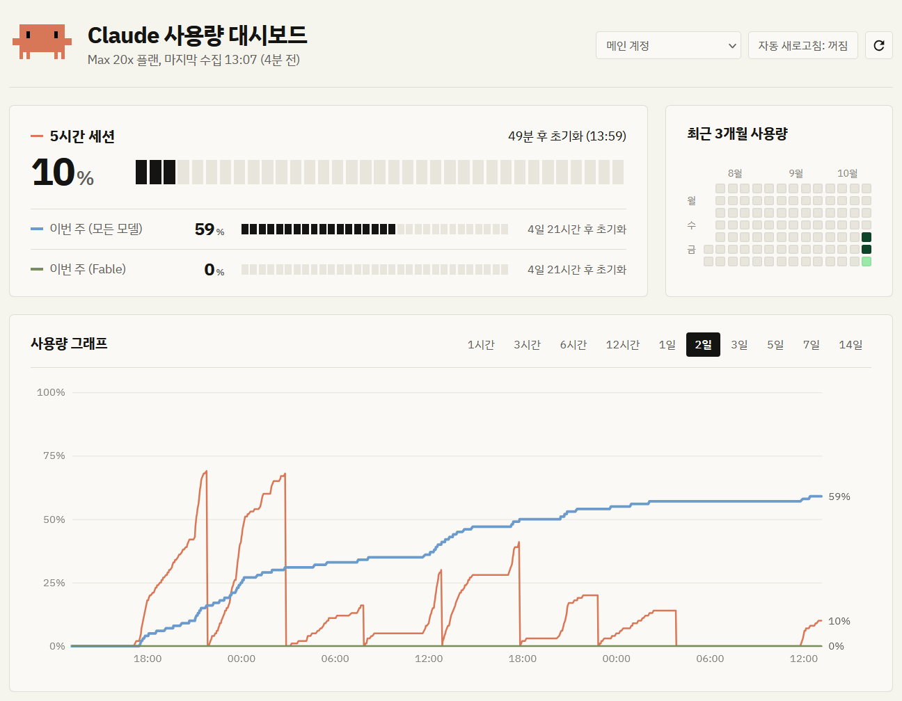

# claude-usage-tracker

Claude Code의 `/usage`가 보여 주는 플랜 사용량(5시간·주간·모델별 주간 사용률)을 계정마다 주기적으로 받아 기록하고, 브라우저 대시보드에서 시간에 따른 그래프와 하루 사용량 잔디로 보여 준다. `/usage`는 지금 값만 보여 주지만, 이 프로그램은 언제 얼마나 썼는지와 창이 언제 초기화됐는지를 남긴다.

- Claude Code가 `/usage`를 열 때 보내는 것과 똑같은 요청을 보낸다. 설치된 Claude Code의 로그인 정보(`.credentials.json`)를 그대로 쓰므로 API 키가 필요 없다.
- 설정 폴더(`~/.claude`, `~/.claude1` 등)로 나눠 쓰는 여러 계정을 한 대시보드에서 함께 본다.
- 대시보드까지 들어간 실행 파일 하나로 Windows와 Linux에서 돈다.



## 데이터 저장

- 원본 응답은 `logs/YYYY-MM-DD-<이메일>.json`에 쌓는다. 쌓기만 하고 프로그램이 다시 읽지 않는다.
- 성공한 응답은 `archive/<이메일>/recent.json`에도 최근 50건을 남긴다. 다시 시작한 뒤 첫 수집이 rate limit 등으로 실패해도 대시보드가 여기의 마지막 값을 보여 준다.
- 5시간·주간 사용률 요약은 `archive/<이메일>/YYYY-MM.json`에 쌓고, 대시보드는 이 요약을 그린다.
- 다시 시작하면 `recent.json`의 마지막 응답을 보고, 꺼져 있는 동안 5시간·주간·모델별 주간(Fable 등) 창이 초기화됐으면 그래프가 초기화 시각에 수직으로 떨어지도록 1초 전에는 마지막 값을, 초기화 시각에는 0%를 적은 요약을 월별 파일에만 넣는다. 그다음 수집을 시작한다.
- 대시보드 사용률 칸 옆 잔디는 최근 3개월 동안 하루에 늘어난 주간(모든 모델) 사용률이다. 하루는 그날 첫 기록부터 다음 날 첫 기록까지라, 자정을 넘겨 꺼져 있던 동안 쓴 양은 꺼지기 전 날에 들어간다. 값이 내려가면 주간 창이 초기화된 것으로 보고 내려간 값을 0부터 센다.
- 날짜와 시각은 머신 시간대가 아니라 `config.json`의 `timezone`(기본 `Asia/Seoul`)으로 적는다. 잔디의 하루 경계, 파일 이름, 기록의 시각 오프셋이 모두 이 시간대다.

## 빌드

```bash
scripts/build.sh
```

Windows에서는 Git Bash로 실행한다. `bin/`에 `cut-windows-amd64.exe`, `cut-linux-amd64`, `cut-linux-arm64`가 생긴다. 대시보드 파일(`internal/dashboard/static/`)은 실행 파일에 들어간다.

- `bin/`의 실행 파일이 실행 중이어도 빌드해도 된다. Windows에서 go는 실행 중인 파일 이름 뒤에 `~`를 붙여 옆으로 치워 두고 새 파일을 쓴다. 새 파일은 프로그램을 다시 시작해야 적용된다.
- `config.json`, `archive/`, `logs/`를 **실행 파일과 같은 폴더**에서 찾는다. 그래서 어느 디렉터리에서 실행하든 같은 기록에 이어 쓰고, 실행 파일을 임시 폴더에 만드는 `go run`으로는 돌릴 수 없다.
- 로그는 콘솔과 함께 `logs/YYYY-MM-DD.log`에도 남는다.

## 테스트

`go test ./...`가 아니라 `scripts/test.sh`로 돌린다. `go test ./...`는 오류 없이 끝나지만 테스트를 하나도 돌리지 않는다.

```bash
scripts/test.sh                                     # 전체 (./internal/...)
scripts/test.sh ./test/poller                       # 패키지 하나 (./internal/poller도 된다)
scripts/test.sh -v -run TestLoadConfig ./test/app   # go test 옵션은 그대로 넘어간다
```

- 테스트는 `test/<패키지>/`에 있지만 비공개 이름을 쓰려고 `internal/<패키지>`와 같은 패키지로 적혀 있다. 스크립트가 `go test -overlay`로 `internal/<패키지>/` 안에 있는 것처럼 컴파일한다.
- 새 테스트 파일 맨 위에는 `//go:build separatetest`와 빈 줄을 둔다. 빠뜨리면 에디터(gopls)와 `go vet ./...`에서 오류가 난다. 태그 때문에 에디터의 자동 완성·타입 검사는 이 파일들에서 동작하지 않는다.
- 테스트는 `internal/<패키지>/`를 작업 디렉터리로 해서 돈다. `testdata/`처럼 테스트가 읽는 파일은 `internal/<패키지>/` 아래에 둔다.

## 수집 대상 계정

`~/.claude`와 `extraClaudeConfigDirs`에 적은 폴더 중 실제로 있는 것만 수집하고, 없거나 열 수 없는 폴더는 조용히 건너뛴다. 서버를 띄운 셸의 `CLAUDE_CONFIG_DIR`는 보지 않는다.

- 계정은 계정 정보 파일의 이메일로 구분한다. `~/.claude`면 `~/.claude.json`, `extraClaudeConfigDirs`에 적은 디렉터리면 `<디렉터리>/.claude.json`이다.
- `config.json`을 **처음 만들 때만** 홈에서 `.claude`로 시작하는 폴더를 찾아 `extraClaudeConfigDirs`에 `~/.claude1`처럼 적어 둔다. 계정 정보와 크리덴셜(`.credentials.json`)이 모두 있는 폴더만 넣고, 적지 않아도 수집하는 `~/.claude`는 뺀다. 이미 `config.json`이 있으면 찾지 않으므로, 계정을 더하거나 뺄 때는 파일을 직접 고친다.
- 시작할 때 수집하는 계정의 이메일과 폴더 경로를 출력한다. 수집할 폴더가 하나도 없으면 오류 없이(종료 코드 0) 끝난다.

## 설정 (`config.json`)

실행할 때 `config.json`이 없으면 기본값과 영문·숫자 32자 랜덤 비밀번호를 넣어 새로 만들고, 다른 사용자가 읽지 못하게 권한을 0600으로 둔다. 키를 빼면 기본값을 쓴다. 모르는 키는 오타를 알아챌 수 있게 경고를 남기고 무시하지만, 값이 잘못된 키는 오류로 보고 시작하지 않는다.

아래 예시의 주석은 설명용이다. 실제 `config.json`은 일반 JSON이라 주석을 넣으면 읽지 못한다.

```jsonc
{
    "dashboard": {
        // 대시보드 주소. 기본 127.0.0.1
        "host": "127.0.0.1",
        // 대시보드 포트. 기본 8788
        "port": 8788,
        // 로그인 비밀번호. ""로 두거나 키를 빼면 아무것도 입력하지 않고 로그인한다.
        // 처음 만들 때 랜덤으로 생성한다.
        "password": "change-me",
        // 로그인 없이 대시보드를 여는 클라이언트 IP 목록. 192.168.0.10이나 192.168.0.0/24로 적는다.
        // 처음 만들 때 127.0.0.1만 넣는다.
        "ipAllowList": [
            "127.0.0.1",
            "192.168.0.0/24"
        ],
        // X-Forwarded-For를 믿을 리버스 프록시 IP 목록. 형식은 ipAllowList와 같다. 기본 없음
        "trustedProxies": []
    },
    // ~/.claude 말고 수집할 Claude Code 설정 디렉터리 목록.
    // ~는 홈, 상대 경로는 config.json 기준이다. 처음 만들 때 홈에서 찾은 폴더를 넣는다.
    "extraClaudeConfigDirs": [
        "~/.claude1",
        "~/.claude2"
    ],
    // 대시보드와 수집 로그에서 이메일 대신 보여 줄 별칭. 키는 이메일(대소문자 구분 없음). 기본 없음
    "accountAliases": {
        "me@example.com": "개인",
        "work@example.com": "회사"
    },
    // 날짜와 시각을 적을 IANA 시간대 이름. 기본 Asia/Seoul
    // 시간대 데이터는 실행 파일에 들어 있어 OS에 없어도 읽힌다.
    "timezone": "Asia/Seoul"
}
```

## 대시보드 로그인

`dashboard.password`로만 로그인한다. 아이디는 없다. 로그인하면 비밀번호를 브라우저에 기한 없이 저장하므로 로그아웃하기 전까지 다시 묻지 않는다. 암호화하지 않고 base64로만 인코딩해 두니, 공용 PC에서는 다 쓴 뒤 로그아웃한다.

- `ipAllowList`에 드는 IP에서는 로그인 없이 열린다.
- 리버스 프록시 뒤에 둘 때는 프록시 주소를 `trustedProxies`에 넣는다. 그래야 `X-Forwarded-For`로 실제 클라이언트 IP를 보고 `ipAllowList`를 적용한다.
- **같은 PC에 리버스 프록시를 두면** 프록시를 거친 요청의 연결 주소가 `127.0.0.1`이라, 처음 만든 `config.json` 그대로는 바깥에서 온 요청도 로그인 없이 열린다. 프록시 주소를 `trustedProxies`에 넣거나 `127.0.0.1`을 `ipAllowList`에서 뺀다. 프록시가 `X-Forwarded-For`를 붙이지 않아도 같은 일이 생긴다.
- 비밀번호는 평문 HTTP로 오간다. 루프백 밖으로 열 때는 HTTPS 리버스 프록시 뒤에 둔다.

## 리눅스에서 서비스로 실행

`claude-usage-tracker.service`는 systemd 시스템 서비스다. 로그인하지 않아도 부팅 때 시작한다. 수집할 `~/.claude`의 주인인 `ubuntu` 사용자로 돌고 실행 파일이 `/home/ubuntu/claude-usage-tracker/`에 있다고 보고 적었으니, 다르면 unit의 `User`, `ExecStart`, `PATH`를 고친다.

```bash
install -Dm755 bin/cut-linux-arm64 ~/claude-usage-tracker/cut-linux-arm64
sudo install -m644 claude-usage-tracker.service /etc/systemd/system/claude-usage-tracker.service
sudo systemctl daemon-reload
sudo systemctl enable --now claude-usage-tracker
```

- 처음 시작하면 실행 파일 옆에 `config.json`이 생기므로 서비스 사용자가 그 폴더에 쓸 수 있어야 한다. 설정을 고쳤으면 `sudo systemctl restart claude-usage-tracker`.
- 토큰 갱신은 `PATH`에서 `claude`를 찾는다. unit은 `~/.local/bin`, `/usr/local/bin`, `/usr/bin`, `/bin`만 넣으므로 claude가 다른 곳에 있으면 `command -v claude`가 가리키는 폴더를 더한다.
- 로그는 `logs/` 또는 `journalctl -u claude-usage-tracker`로 본다.
